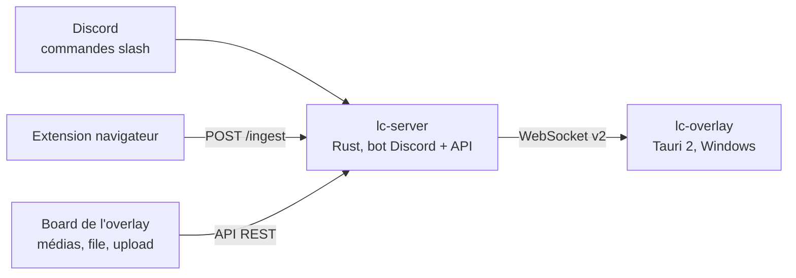

# LiveChat

LiveChat affiche des médias en direct sur un stream : une vidéo, une image ou un
tweet envoyé depuis Discord, le navigateur ou la board apparaît par-dessus le jeu,
dans un overlay transparent posé sur l'écran du streamer.

Version actuelle : **3.1** — serveur `3.1.0`, overlay Windows `3.1.0`.



## Installer

- **Overlay Windows** : installeur `LiveChat_<version>_x64-setup.exe` de la
  [dernière release](https://github.com/quentingimenez/LiveChat/releases/latest),
  installation par utilisateur sans droits admin. L'appairage avec un serveur Discord
  se fait depuis la board.
- **Serveur** : image Docker `ghcr.io/quentingimenez/livechat-server`
  (`:latest` ou une version épinglée, par exemple `:3.1.0`), exemple de déploiement
  dans [`deploy/docker-compose.yml`](deploy/docker-compose.yml) et procédure complète
  dans [`docs/rust/packaging.md`](docs/rust/packaging.md).

```bash
docker pull ghcr.io/quentingimenez/livechat-server:latest
```

## Contenu du dépôt

| Dossier | Rôle |
| --- | --- |
| [`apps/lc-server`](apps/lc-server) | Serveur : bot Discord, API overlay et ingestion, WebSocket v2, panneau d'administration |
| [`apps/lc-overlay`](apps/lc-overlay) | Overlay desktop Tauri 2 (Windows) : affichage des médias et board (médias, file, réglages, placement de la zone d'affichage) |
| [`crates/`](crates) | Bibliothèques partagées : protocole (`lc-protocol`), domaine, base SQLite (`lc-db`), pipeline média yt-dlp + ffmpeg (`lc-media`), lecture (`lc-playback`), Discord (`lc-discord`) |
| [`static/admin`](static/admin) | Panneau d'administration servi par le serveur sur `/admin/` |
| [`extension/`](extension) | Extension Chromium MV3 qui envoie des liens (YouTube, TikTok, X) vers `/ingest` |
| [`deploy/`](deploy) | Dockerfile de production et Docker Compose du serveur |
| [`docs/`](docs) | Documentation technique (`docs/rust/`) et charte graphique (`docs/brand/`) |
| [`xtask/`](xtask) | Outillage du workspace (harnais de parité, etc.) |

## Développement

Prérequis : Rust stable (voir [`rust-toolchain.toml`](rust-toolchain.toml)),
`tauri-cli` 2 pour l'overlay (`cargo install tauri-cli --version ^2`), Node 20+ pour
l'extension et les tests JS de l'overlay.

```bash
cargo test --workspace
cargo clippy --workspace --all-targets -- -D warnings
cargo run -p lc-server
node --test apps/lc-overlay/dev/tests/*.mjs
```

Overlay en local, sans clé de signature des mises à jour :

```bash
cd apps/lc-overlay
cargo tauri build --config tauri.unsigned.conf.json
```

La board peut aussi tourner dans un navigateur, sans Tauri ni serveur, avec le harnais
`apps/lc-overlay/dev/board-mock.html` (voir [`apps/lc-overlay/dev/README.md`](apps/lc-overlay/dev/README.md)).

## Releases

| Projet | Tag | Résultat |
| --- | --- | --- |
| Serveur | `server-vX.Y.Z` | Image `ghcr.io/quentingimenez/livechat-server:X.Y.Z` et `:latest`, après smoke test ([`server-image.yml`](.github/workflows/server-image.yml)) |
| Overlay | `overlay-vX.Y.Z` (= `version` de `apps/lc-overlay/tauri.conf.json`) | Brouillon de release avec l'installeur signé et `latest.json` ([`overlay-tauri.yml`](.github/workflows/overlay-tauri.yml)) |
| Extension | `extension-vX.Y.Z` | Zip et publication Chrome Web Store ([`extension.yml`](.github/workflows/extension.yml)) |

L'overlay se met à jour tout seul à partir de la release marquée **Latest** : il
vérifie à chaque ouverture de la board, télécharge la nouvelle version en arrière-plan
et l'installe au clic de l'utilisateur. Publier le brouillon d'une release overlay et
le marquer *Latest* déclenche donc la mise à jour de tous les overlays installés ;
seules les releases stables de l'overlay doivent être *Latest*. Détails :
[`docs/rust/overlay-release.md`](docs/rust/overlay-release.md).

La CI Rust ([`rust.yml`](.github/workflows/rust.yml)) vérifie le formatage, clippy,
les tests, `cargo deny` et `cargo audit` sous Linux et Windows.

## Historique

L'ancienne version 2.x (serveur Node/Prisma et overlay Electron) a été retirée du dépôt ;
ses sources sont archivées au tag `legacy-ts-2.0.2`
(`git checkout legacy-ts-2.0.2 -- server overlay`). Les chemins `server/…` et
`overlay/…` cités en commentaire dans le code Rust renvoient à ce tag.
