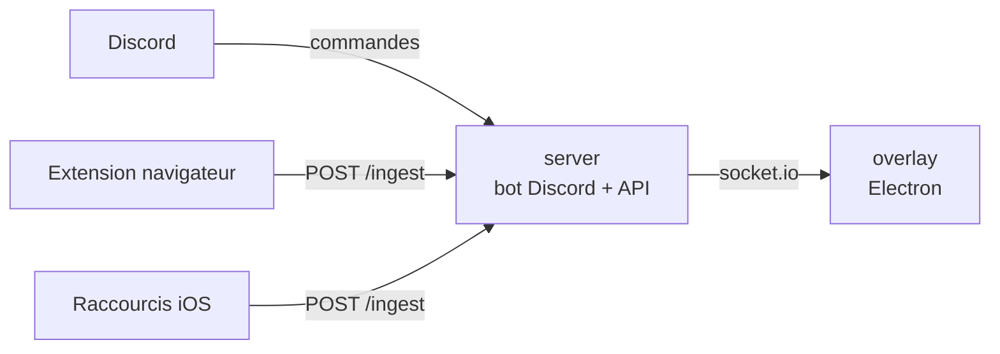

# LiveChat

Monorepo LiveChat: envoi de médias (Discord, navigateur, raccourcis iOS) vers un overlay desktop affiché en stream.



## Projets

| Dossier | Rôle | Stack | Livrable |
| --- | --- | --- | --- |
| [`server/`](server) | Bot Discord + API (`/overlay/*`, `/ingest`, `/admin`), pipeline média (yt-dlp + ffmpeg) | Node 20, TypeScript, Fastify, Prisma/SQLite, pnpm | Image Docker `ghcr.io/quentingimenez/livechat-server` |
| [`overlay/`](overlay) | Client desktop qui reçoit et affiche les médias | Electron, TypeScript, npm | `.exe` Windows (setup + portable) avec auto-update |
| [`extension/`](extension) | Extension Chromium MV3 qui envoie des liens vers `/ingest` | TypeScript, Vite, npm | Zip + Chrome Web Store |

Chaque projet reste autonome: son propre gestionnaire de paquets, son lockfile et son README (démarrage, configuration, build).

## Démarrage

Prérequis: Node 22 (Node 20 suffit pour `server/` et `extension/`), pnpm 10 (`corepack enable`), Python 3 (zip de l'extension), Docker (optionnel).

```bash
npm install          # outillage racine: hooks git (husky) + commitlint
npm run install:all  # dépendances des 3 projets
```

Scripts racine (raccourcis vers les projets):

| Script | Équivalent |
| --- | --- |
| `npm run server:dev` | `pnpm --dir server dev` |
| `npm run server:test` | `pnpm --dir server test` |
| `npm run overlay:start` | `npm --prefix overlay start` |
| `npm run overlay:verify` | `npm --prefix overlay run verify` |
| `npm run extension:build` | `npm --prefix extension run build` |
| `npm run extension:check` | `npm --prefix extension run ci:check` |

## CI/CD (GitHub Actions)

Les workflows sont à la racine (`.github/workflows/`) et ne se déclenchent que sur les changements du projet concerné.

| Workflow | Déclencheur | Résultat |
| --- | --- | --- |
| [`server.yml`](.github/workflows/server.yml) | PR / push `main` sur `server/**`, tag `server-v*` | Tests + image Docker poussée sur GHCR (build sans push sur PR) |
| [`overlay-ci.yml`](.github/workflows/overlay-ci.yml) | PR / push `main` sur `overlay/**` | `npm run verify` (lint, typecheck, build, tests) |
| [`overlay-nightly.yml`](.github/workflows/overlay-nightly.yml) | Push `main` sur `overlay/**` | Prerelease `overlay-nightly` (`.exe` portable) |
| [`overlay-release.yml`](.github/workflows/overlay-release.yml) | Tag `overlay-vX.Y[.Z]` | Release stable marquée *Latest* (setup + portable + `latest.yml`) |
| [`extension.yml`](.github/workflows/extension.yml) | PR / push `main` sur `extension/**`, tag `extension-v*` | Checks + zip, prerelease `extension-latest`, release + Chrome Web Store |

### Tags de version

| Projet | Tag | Exemple |
| --- | --- | --- |
| server | `server-vX.Y.Z` | `server-v1.0.0` → image `ghcr.io/quentingimenez/livechat-server:1.0.0` |
| overlay | `overlay-vX.Y` ou `overlay-vX.Y.Z` (doit correspondre à `overlay/package.json`) | `overlay-v2.0.2` |
| extension | `extension-vX.Y.Z` | `extension-v0.1.0` |

> L'auto-update de l'overlay (`electron-updater`) lit la release **Latest** du dépôt. Seules les releases
> stables de l'overlay sont marquées *Latest*; les autres releases sont créées en prerelease ou avec `latest=false`.
> Ne pas marquer manuellement une autre release comme *Latest*.

### Image Docker du serveur

```bash
docker pull ghcr.io/quentingimenez/livechat-server:latest
```

Exemple de déploiement: [`server/docker-compose.yml`](server/docker-compose.yml).

## Conventions

- Commits au format [Conventional Commits](https://www.conventionalcommits.org/), vérifiés par commitlint (`commit-msg`). Utiliser le projet en scope: `feat(server): ...`, `fix(overlay): ...`, `chore(extension): ...`.
- `pre-commit`: tests unitaires du serveur si des fichiers `server/` sont indexés.
- `pre-push`: `pnpm audit --prod` (niveau `critical`) sur le serveur.

## Migration depuis les anciens dépôts

L'historique git complet des trois dépôts a été importé dans leurs sous-dossiers (`git log -- overlay/` fonctionne).
Les anciens tags de l'overlay sont renommés `overlay-v*`.

| Ancien dépôt | Dossier |
| --- | --- |
| [WardenPro/LiveChat-Bot](https://github.com/WardenPro/LiveChat-Bot) → fork [quentingimenez/LiveChat-server](https://github.com/quentingimenez/LiveChat-server) | `server/` |
| [quentingimenez/LiveChat-Overlay](https://github.com/quentingimenez/LiveChat-Overlay) | `overlay/` |
| [quentingimenez/LiveChat-Extension](https://github.com/quentingimenez/LiveChat-Extension) | `extension/` |

Actions à faire une seule fois:

1. **Visibilité de l'image GHCR**: un package GHCR est privé à sa création. Pour un `docker pull` sans authentification,
   *Packages → livechat-server → Package settings → Change visibility → Public*.
2. **Chrome Web Store**: ajouter les secrets `CWS_EXTENSION_ID`, `CWS_CLIENT_ID`, `CWS_CLIENT_SECRET`, `CWS_REFRESH_TOKEN` au monorepo (voir [`extension/README.md`](extension/README.md)).
3. **Auto-update des overlays déjà installés (≤ 2.0.1)**: ils interrogent encore les releases de `LiveChat-Overlay`.
   Après la première release `overlay-vX.Y.Z` du monorepo, republier ses fichiers (setup, portable, `latest.yml`, `*.blockmap`)
   dans une release `X.Y.Z` de l'ancien dépôt: une fois cette version installée, les clients suivent le monorepo.

   ```bash
   gh release download overlay-v2.0.2 -R quentingimenez/LiveChat -D bridge
   gh release create 2.0.2 bridge/* -R quentingimenez/LiveChat-Overlay --title 2.0.2 --notes "Dernière version publiée ici: les mises à jour viennent désormais de quentingimenez/LiveChat."
   ```

4. Archiver les anciens dépôts une fois la migration validée.
