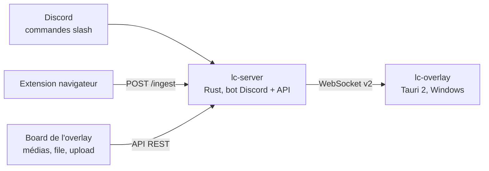
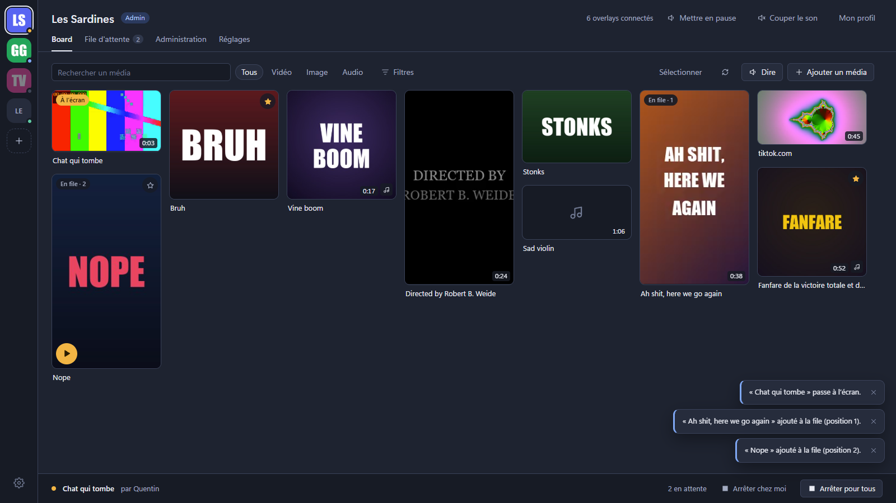
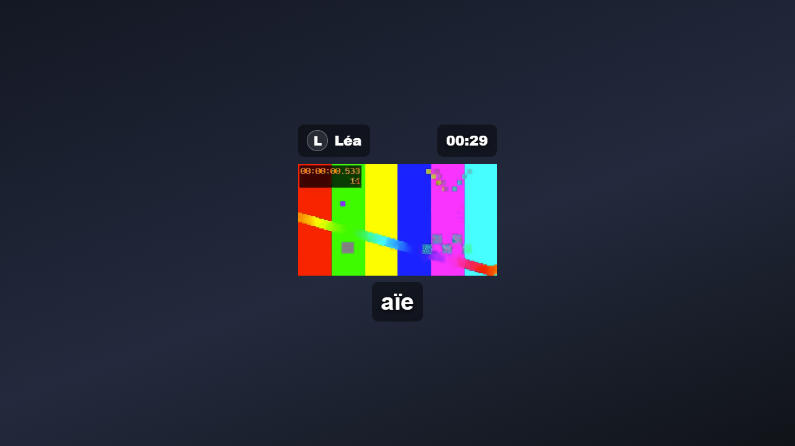

<p align="center">
  
</p>

# LiveChat

[](https://github.com/quentingimenez/LiveChat/actions/workflows/rust.yml)

LiveChat affiche des médias en direct sur un stream : une vidéo, une image ou un
texte envoyé depuis Discord, le navigateur ou la board apparaît par-dessus le jeu,
dans un overlay transparent posé sur l'écran du streamer.



## Aperçu

**La board** — la fenêtre de contrôle de l'overlay : bibliothèque de médias du
serveur Discord (avec vignettes), barre « en direct » et file d'attente, rail des
guildes, réglages et appairage.

[](docs/screenshots/board.png)

**L'affichage des médias** — le média posé par-dessus le jeu : cadre vidéo,
auteur, légende et compte à rebours ; tout le reste de l'écran reste transparent.

[](docs/screenshots/overlay.png)

*Captures réalisées avec le harnais de développement de l'overlay
([`apps/lc-overlay/dev/`](apps/lc-overlay/dev)) — données de démonstration.*

## Fonctionnalités

- **Overlay Windows** : rendu transparent par-dessus le jeu, zone d'affichage placée
  depuis la board, volume et pause par serveur, mises à jour automatiques signées
  annoncées en haut de la board.
- **Board** (fenêtre de l'overlay) : bibliothèque de médias par serveur Discord
  (favoris, filtres, raccourcis), file d'attente, uploads locaux, éditeur image et
  audio/vidéo, sélection multiple (jouer, favori, copier les liens ou les médias vers
  un autre serveur, supprimer), « Jouer une fois » sans ajouter à la board, « Faire
  dire un texte » synthétisé côté serveur, réglages de l'appareil et du serveur,
  appairage par code, profil.
- **Serveur** : bot Discord (commandes slash), ingestion YouTube, TikTok et X
  (yt-dlp + ffmpeg, volume normalisé), URLs média signées, droits par rôle, base
  SQLite, WebSocket v2 avec heartbeat, endpoint `/health` pour la supervision.
- **Console d'administration** (servie sur `/admin/`) : santé du serveur, guildes et
  membres, appareils overlay et ingestion, codes d'appairage, cache média, droits par
  rôle, journal d'activité ; connexion par secret ou compte Discord.
- **Extension Chromium** : envoi en un clic depuis YouTube, TikTok et X (bouton
  in-page, menu contextuel, popup avec texte) et appairage par code.

## Installation

### Overlay Windows

Installeur `LiveChat_<version>_x64-setup.exe` de la
[dernière release](https://github.com/quentingimenez/LiveChat/releases/latest) :
installation par utilisateur dans `%LOCALAPPDATA%`, sans droits admin.
L'appairage avec un serveur Discord se fait depuis la board, avec un code
`/pair-code` tapé sur Discord ou une invitation créée par un admin.

### Serveur

Image Docker `ghcr.io/quentingimenez/livechat-server` (`:latest` ou une version
épinglée), exemple de déploiement dans [`deploy/docker-compose.yml`](deploy/docker-compose.yml)
(secrets dans `deploy/.env`, modèle [`deploy/.env.example`](deploy/.env.example)) et
procédure complète dans [`docs/rust/packaging.md`](docs/rust/packaging.md). Le
conteneur n'écoute que sur `127.0.0.1` : placez-le derrière un reverse proxy TLS.

```bash
docker pull ghcr.io/quentingimenez/livechat-server:latest
```

### Extension Chromium

Zip attaché aux [releases](https://github.com/quentingimenez/LiveChat/releases) —
la release `extension-latest` est recompilée en continu depuis `main` — ou
chargement en mode développeur, voir [`extension/README.md`](extension/README.md).

## Contenu du dépôt

| Dossier | Rôle |
| --- | --- |
| [`apps/lc-server`](apps/lc-server) | Serveur : bot Discord, API overlay et ingestion, WebSocket v2, console d'administration embarquée |
| [`apps/lc-overlay`](apps/lc-overlay) | Overlay desktop Tauri 2 (Windows) : affichage des médias et board |
| [`apps/lc-admin-web`](apps/lc-admin-web) | Console d'administration (Preact + TypeScript), compilée par Vite et embarquée dans le serveur, servie sur `/admin/` |
| [`crates/`](crates) | Bibliothèques partagées : protocole (`lc-protocol`), domaine, base SQLite (`lc-db`), pipeline média yt-dlp + ffmpeg (`lc-media`), lecture (`lc-playback`), Discord (`lc-discord`) |
| [`extension/`](extension) | Extension Chromium MV3 qui envoie des liens (YouTube, TikTok, X) vers `/ingest` |
| [`deploy/`](deploy) | Dockerfile de production et Docker Compose du serveur |
| [`docs/`](docs) | Documentation technique (`docs/rust/`) et charte graphique (`docs/brand/`) |
| [`xtask/`](xtask) | Outillage du workspace (harnais de parité, etc.) |

## Développement

Prérequis : Rust stable (voir [`rust-toolchain.toml`](rust-toolchain.toml)),
`tauri-cli` 2 pour l'overlay (`cargo install tauri-cli --version ^2`) et Node 20+
pour l'extension, la console d'administration et les tests JS de l'overlay.

```bash
cargo test --workspace
cargo clippy --workspace --all-targets -- -D warnings
cargo run -p lc-server
node --test apps/lc-overlay/dev/tests/*.mjs       # tests JS de l'overlay
npm --prefix extension run ci:check               # extension : typecheck, lint, tests, build
```

`cargo build`/`cargo test` sur `lc-server` construit la console d'administration
automatiquement (`npm ci` puis `npm run build` depuis `apps/lc-server/build.rs`) quand
`apps/lc-admin-web` a changé ; sans Node, l'étape est ignorée avec un avertissement et le
serveur sert la page « console non construite ». `LC_ADMIN_WEB_BUILD=0` désactive cette
construction (l'image Docker fournit `dist/`). La console a aussi ses tests unitaires
(`npm test` dans `apps/lc-admin-web`) et des tests E2E Playwright contre le vrai
serveur (`npm run e2e`).

Overlay en local, sans clé de signature des mises à jour :

```bash
cd apps/lc-overlay
cargo tauri build --config tauri.unsigned.conf.json
```

La board peut aussi tourner dans un navigateur, sans Tauri ni serveur, avec le harnais
`apps/lc-overlay/dev/board-mock.html` (voir [`apps/lc-overlay/dev/README.md`](apps/lc-overlay/dev/README.md)).

## Vérification

Le pipeline de vérification (propriétés, contrats, fuzz, mutation, charge, chaos,
canary) est décrit dans [`docs/rust/verification.md`](docs/rust/verification.md) :
la batterie locale tient en `cargo xtask verify --offline` (plus `--mutants` pour la
mutation, kill-or-justify), le nightly [`verification-nightly.yml`](.github/workflows/verification-nightly.yml)
note les scores contre [`scripts/mutants-baseline.json`](scripts/mutants-baseline.json),
et le skill [`/verify`](.claude/skills/verify/SKILL.md) encadre tout changement écrit
par un agent jusqu'au canary, avant tout déploiement.

## Releases

Une release se prépare avec [`scripts/release.ps1`](scripts/release.ps1) (`plan`,
`bump`, `check`, `deploy-server`) en suivant le skill
[`/release`](.claude/skills/release/SKILL.md) : PR `release/*` qui change les
versions, puis au merge [`release.yml`](.github/workflows/release.yml) pose les tags
ci-dessous sur le commit de merge et lance les builds. Le serveur est ensuite
déployé, puis la release overlay publiée en *Latest*.
[`release-check.yml`](.github/workflows/release-check.yml) refuse une PR où un
composant n'a pas la même version dans tous ses fichiers.

| Composant | Tag | Résultat |
| --- | --- | --- |
| Serveur | `server-v*` | Image versionnée correspondante et `:latest` sur GHCR, publiée après un smoke test du conteneur ([`server-image.yml`](.github/workflows/server-image.yml)) |
| Overlay | `overlay-v*` (= `version` de [`apps/lc-overlay/tauri.conf.json`](apps/lc-overlay/tauri.conf.json)) | Brouillon de release avec l'installeur signé et `latest.json` ([`overlay-tauri.yml`](.github/workflows/overlay-tauri.yml)) |
| Extension | `extension-v*` (= `version` de `extension/public/manifest.json`) | Release GitHub avec le zip, pas de Chrome Web Store pour l'instant ([`extension.yml`](.github/workflows/extension.yml)) |

L'overlay se met à jour tout seul à partir de la release marquée **Latest** : il
vérifie à chaque ouverture de la board, télécharge la nouvelle version en arrière-plan
et l'installe au clic de l'utilisateur. Publier le brouillon d'une release overlay et
le marquer *Latest* déclenche donc la mise à jour de tous les overlays installés ;
seules les releases stables de l'overlay doivent être *Latest* (les releases de
l'extension ne le sont jamais). Détails :
[`docs/rust/overlay-release.md`](docs/rust/overlay-release.md).

La CI Rust ([`rust.yml`](.github/workflows/rust.yml)) vérifie le formatage, clippy
(`-D warnings`), la MSRV, les tests (Linux et Windows, doctests inclus), la console
d'administration (typecheck, tests, build, E2E), la construction de l'image Docker
avec smoke test, `cargo deny` et `cargo audit`.

## Historique

Avant la réécriture en Rust, le dépôt contenait un serveur Node/Prisma et un overlay
Electron ; ces sources ont été retirées du dépôt et archivées au tag git
`legacy-ts-2.0.2` (`git checkout legacy-ts-2.0.2 -- server overlay`). Les chemins
`server/…` et `overlay/…` cités en commentaire dans le code Rust renvoient à ce tag.
